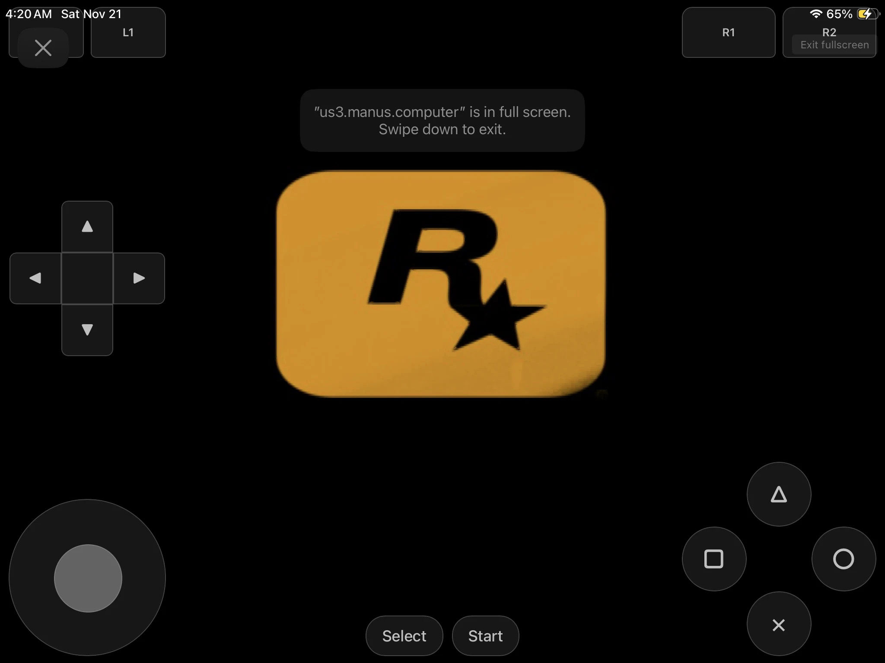

# GTA SA WASM

An experimental WebAssembly build of the PlayStation 2 version of Grand Theft Auto: San Andreas, built with the PS2 Web Recomp project.

> **Experimental — not playable on iOS Safari yet:** The iOS Safari screenshot below shows the startup screen and touch controls only; it does not show playable gameplay. This is a diagnostic build, not a verified stable release. A cloud desktop Chrome run rendered an intro/credits frame, but a longer run encountered runtime errors.

## Download

Download the prebuilt Safari 26 archive from the [GTA SA WASM release](https://github.com/Quincunx33/Gta-sa-wasm/releases/tag/ios26-safari-latest6):

- `GTASA-iOS26-Safari-latest6.zip`

The archive contains the compiled web files (`ps2web.html`, `ps2web.js`, `ps2web.wasm`, and `ps2web.data`). **It does not include the game disc image.**

## Run the prebuilt build

1. Extract the ZIP into a directory served by a local or remote web server.
2. Supply your own legally obtained PS2 game image as `disc.iso`, beside `ps2web.html` (the page requests it from `/disc.iso`).
3. Serve the page from the same origin as the ISO. The server must support HTTP byte-range requests and return these headers:

   ```http
   Cross-Origin-Opener-Policy: same-origin
   Cross-Origin-Embedder-Policy: require-corp
   ```

The page streams the disc image; do not put the ISO in this repository or in the release archive. A static file server that lacks the required headers or byte-range support will not work correctly.

## Build from source

A PS2 ISO is required to generate a game-specific build. Keep it local and out of Git. From the repository root, place your own image at `games/gtasa/disc.iso`, then run:

```bash
scripts/port.sh gtasa games/gtasa/disc.iso
PS2_WEB_SAFARI26=ON scripts/build_web.sh gtasa
python3 scripts/serve.py build/web-gtasa-safari games/gtasa/disc.iso --game games/gtasa
```

The Safari compatibility build is less efficient than the standard browser build. See the scripts and source documentation for build dependencies and additional options.

## Screenshots

The first image is from iOS Safari and shows the startup screen with touch controls—not playable gameplay. The other captures are from cloud desktop Chrome: the intro image shows a rendered frame, and the diagnostics image records errors encountered during a later run. None demonstrates a stable, playable game.




## Controls

The page supports touch controls and browser gamepads. Keyboard mapping: **Z** = Cross, **X** = Circle, **A** = Square, **S** = Triangle, **Q/W/1/2** = shoulder buttons, **Enter** = Start, **Backspace** = Select, **arrow keys** = D-pad, and **I/J/K/L** = left stick. Press **F** for fullscreen.

## Legal and licensing

This repository contains project source code and build tooling; it does not include the game ISO. Use only game images you are legally entitled to use. Grand Theft Auto and related marks are the property of their respective owners; this project is unofficial and is not affiliated with or endorsed by Rockstar Games or Sony Interactive Entertainment.

The repository code is licensed under the [MIT License](LICENSE). Third-party components retain their respective licenses and notices.
