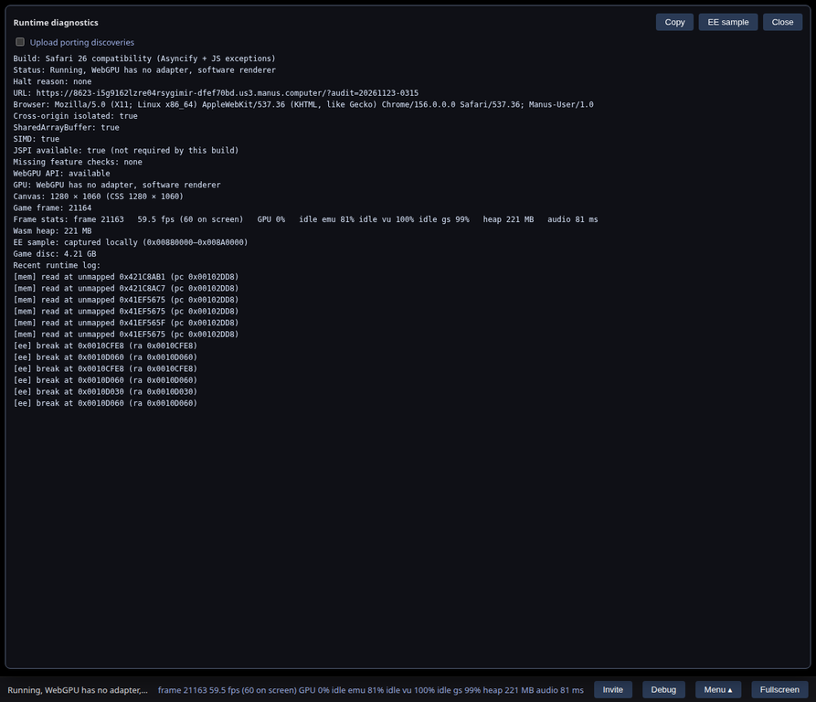

# GTA San Andreas — WebAssembly

<p align="center">
  <strong>An experimental browser-based port of the PS2 version of Grand Theft Auto: San Andreas.</strong>
  <br />
  Built with the <a href="https://github.com/ps2web/ps2web">PS2 Web Recomp</a> project and adapted for iOS Safari 26.
</p>

<p align="center">
  <a href="https://github.com/Quincunx33/Gta-sa-wasm/releases/tag/ios26-safari-latest6">Latest Safari build</a>
  ·
  <a href="https://github.com/Quincunx33/Gta-sa-wasm/issues">Report an issue</a>
</p>

> [!WARNING]
> **Experimental — gameplay is not yet verified as playable.** The iOS Safari capture shows the startup screen and touch controls, not working gameplay. The desktop Chrome captures show an intro/credits frame and a later runtime-error state. This is a work in progress, not a stable game release.

## What is this?

This project explores running the PlayStation 2 version of **Grand Theft Auto: San Andreas** in a modern web browser through WebAssembly.

The current work focuses on an iOS Safari 26-compatible build, browser input support, and loading a user-provided game image at runtime.

## Download a prebuilt version

Get the prebuilt archive from the [latest iOS Safari release](https://github.com/Quincunx33/Gta-sa-wasm/releases/tag/ios26-safari-latest6).

**Archive:** `GTASA-iOS26-Safari-latest6.zip`

The archive contains:

- `ps2web.html` — browser entry point
- `ps2web.js` — JavaScript runtime
- `ps2web.wasm` — WebAssembly module
- `ps2web.data` — packaged application data

### Where does the ISO go?

After extracting the ZIP, put your legally obtained PS2 ISO in the **same folder as `ps2web.html`** and rename it to:

```text
disc.iso
```

Your folder should look like this:

```text
GTASA-iOS26-Safari/
├── ps2web.html
├── ps2web.js
├── ps2web.wasm
├── ps2web.data
└── disc.iso
```

The game image is not included in the release. Use only an ISO you are legally entitled to use.

### Serve the prebuilt version

From the repository root, run:

```bash
python3 scripts/serve.py /path/to/GTASA-iOS26-Safari /path/to/GTASA-iOS26-Safari/disc.iso
```

Replace both paths with the actual extracted folder and ISO paths. Then open:

```text
http://localhost:8620/
```

The included server handles HTTP byte ranges and sends the cross-origin isolation headers required by WebAssembly.

## Build from source

This section is for building the project yourself, not for running the downloaded ZIP.

### 1. Put the ISO in the correct folder

From the repository root, create this folder if it does not exist:

```text
games/gtasa/
```

Copy your legally obtained PS2 ISO into that folder and name it exactly:

```text
games/gtasa/disc.iso
```

Your repository should now contain:

```text
Gta-sa-wasm/
├── games/
│   └── gtasa/
│       └── disc.iso
├── scripts/
└── ...
```

**Do not put the ISO in `build/`, `docs/`, or beside `README.md`. Do not commit or upload it to GitHub.**

### 2. Port the game and build the browser version

Run these commands from the repository root:

```bash
scripts/port.sh gtasa games/gtasa/disc.iso
```

This processes the disc image, translates the game code, and builds the native and standard web targets. The first run may take time because required build tools and dependencies may need to be set up.

### 3. Build the iOS Safari 26 version

After the port step completes successfully, run:

```bash
PS2_WEB_SAFARI26=ON scripts/build_web.sh gtasa
```

The Safari build is written to:

```text
build/web-gtasa-safari/
```

### 4. Run it locally

Start the included server:

```bash
python3 scripts/serve.py build/web-gtasa-safari games/gtasa/disc.iso --game games/gtasa
```

Then open this address in your browser:

```text
http://localhost:8620/
```

Keep the server running while using the page. The server maps the ISO to `/disc.iso` and supports byte-range requests.

### Build output layout

After a successful build, the relevant files and folders look like this:

```text
Gta-sa-wasm/
├── games/
│   └── gtasa/
│       └── disc.iso
├── build/
│   └── web-gtasa-safari/
│       ├── ps2web.html
│       ├── ps2web.js
│       ├── ps2web.wasm
│       └── ps2web.data
└── scripts/
```

### Required server configuration

If you use a different web server instead of the included `scripts/serve.py`, it must support HTTP byte-range requests and send these response headers:

```http
Cross-Origin-Opener-Policy: same-origin
Cross-Origin-Embedder-Policy: require-corp
```

Without byte-range support and cross-origin isolation, the build may fail to initialize.

## Screenshots & test status

Screenshots are separated by the platform they were captured on. These are test snapshots, not proof of stable gameplay.

### iOS — Safari 26

<p align="center">
  
  <br />
  <sub>iPhone/iPad Safari 26 · Startup screen and touch controls · Gameplay not yet verified</sub>
</p>

### Desktop — Cloud Chrome

<p align="center">
  
  <br />
  <sub>Desktop cloud Chrome · Intro / credits frame rendered</sub>
</p>

<p align="center">
  
  <br />
  <sub>Desktop cloud Chrome · Runtime diagnostics from a later run</sub>
</p>

## Controls

The browser page supports touch controls and gamepads.

| Keyboard | PS2 button |
|:--|:--|
| `Z` | Cross |
| `X` | Circle |
| `A` | Square |
| `S` | Triangle |
| `Q` / `W` / `1` / `2` | Shoulder buttons |
| `Enter` | Start |
| `Backspace` | Select |
| Arrow keys | D-pad |
| `I` / `J` / `K` / `L` | Left stick |
| `F` | Fullscreen |

## Important notes

- This is an unofficial technical experiment; compatibility and performance are still being investigated.
- The repository and release do not provide the commercial game or its disc image.
- Do not upload, distribute, or commit copyrighted game files.
- Use only game images you are legally entitled to use.

## Legal

Grand Theft Auto, Grand Theft Auto: San Andreas, and related names and marks belong to their respective owners. This project is unofficial and is not affiliated with, endorsed by, or sponsored by Rockstar Games or Sony Interactive Entertainment.

The repository's original code is licensed under the [MIT License](LICENSE). Third-party components remain subject to their own licenses and notices.
