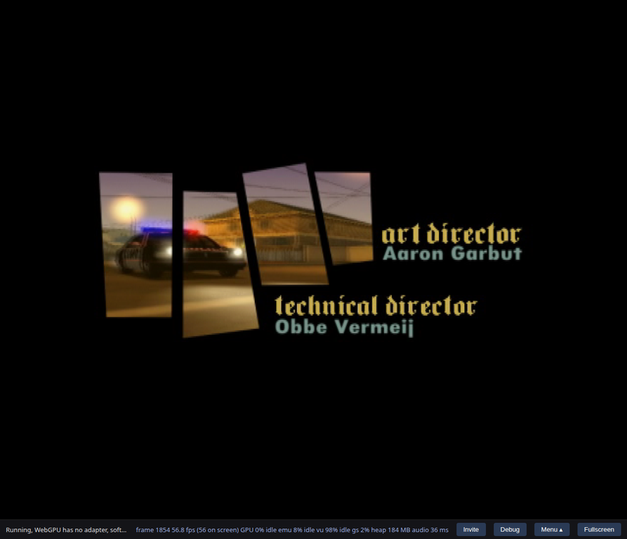

# GTA San Andreas — WebAssembly

<p align="center">
  <strong>An experimental browser-based port of the PS2 version of Grand Theft Auto: San Andreas.</strong>
  <br />
  Built with the <a href="https://github.com/ps2web/ps2web">PS2 Web Recomp</a> project and adapted for iOS Safari 26.
</p>

<p align="center">
  <a href="https://github.com/Quincunx33/Gta-sa-wasm/releases/tag/ios26-safari-latest6">Latest Safari build</a>
  ·
  <a href="https://github.com/Quincunx33/Gta-sa-wasm/issues">Report an issue</a>
</p>

> [!WARNING]
> **Experimental — gameplay is not yet verified as playable.** The iOS Safari capture shows the startup screen and touch controls, not working gameplay. The desktop Chrome captures show an intro/credits frame and a later runtime-error state. This is a work in progress, not a stable game release.

## What is this?

This project explores running the PlayStation 2 version of **Grand Theft Auto: San Andreas** in a modern web browser through WebAssembly.

The current work focuses on an iOS Safari 26-compatible build, browser input support, and loading a user-provided game image at runtime.

## Download

Get the prebuilt archive from the [latest iOS Safari release](https://github.com/Quincunx33/Gta-sa-wasm/releases/tag/ios26-safari-latest6).

**Archive:** `GTASA-iOS26-Safari-latest6.zip`

The archive contains the compiled web application:

- `ps2web.html` — browser entry point
- `ps2web.js` — JavaScript runtime
- `ps2web.wasm` — WebAssembly module
- `ps2web.data` — packaged application data

The game disc image is **not included**. You must provide your own legally obtained PS2 ISO.

## Run the build

1. Download and extract the release ZIP.
2. Place your legally obtained game image beside `ps2web.html`, named `disc.iso`.
3. Serve the directory over HTTP or HTTPS from a server configured for cross-origin isolation and byte-range requests.
4. Open the page in a supported browser.

The ISO is requested from `/disc.iso` and streamed by the page. Keep it on the same origin as the web application.

### Required server configuration

Your server must support HTTP byte-range requests and send these response headers:

```http
Cross-Origin-Opener-Policy: same-origin
Cross-Origin-Embedder-Policy: require-corp
```

A basic static server without these headers or byte-range support may fail to initialize the build correctly.

## Build from source

A PS2 game image is required for the game-specific porting and build steps. Keep the ISO local; **do not commit it or upload it to GitHub**.

Place your own image at `games/gtasa/disc.iso`, then run from the repository root:

```bash
scripts/port.sh gtasa games/gtasa/disc.iso

PS2_WEB_SAFARI26=ON scripts/build_web.sh gtasa

python3 scripts/serve.py build/web-gtasa-safari games/gtasa/disc.iso --game games/gtasa
```

The Safari compatibility build may be less efficient than the standard browser build. Check the repository scripts and source documentation for required dependencies and additional build options.

## Screenshots & test status

Screenshots are separated by the platform they were captured on. **The iOS image is shown first; the desktop Chrome test captures are listed separately below.** These are test snapshots, not proof of stable gameplay.

### iOS — Safari 26

<p align="center">
  
  <br />
  <sub>iPhone/iPad Safari 26 · Startup screen and touch controls · Gameplay not yet verified</sub>
</p>

### Desktop — Cloud Chrome

<p align="center">
  
  <br />
  <sub>Desktop cloud Chrome · Intro / credits frame rendered</sub>
</p>

<p align="center">
  
  <br />
  <sub>Desktop cloud Chrome · Runtime diagnostics from a later run</sub>
</p>

## Controls

The browser page supports touch controls and gamepads.

| Keyboard | PS2 button |
|:--|:--|
| `Z` | Cross |
| `X` | Circle |
| `A` | Square |
| `S` | Triangle |
| `Q` / `W` / `1` / `2` | Shoulder buttons |
| `Enter` | Start |
| `Backspace` | Select |
| Arrow keys | D-pad |
| `I` / `J` / `K` / `L` | Left stick |
| `F` | Fullscreen |

## Important notes

- This is an unofficial technical experiment; compatibility and performance are still being investigated.
- The repository and release do not provide the commercial game or its disc image.
- Do not upload, distribute, or commit copyrighted game files.
- Use only game images you are legally entitled to use.

## Legal

Grand Theft Auto, Grand Theft Auto: San Andreas, and related names and marks belong to their respective owners. This project is unofficial and is not affiliated with, endorsed by, or sponsored by Rockstar Games or Sony Interactive Entertainment.

The repository's original code is licensed under the [MIT License](LICENSE). Third-party components remain subject to their own licenses and notices.
